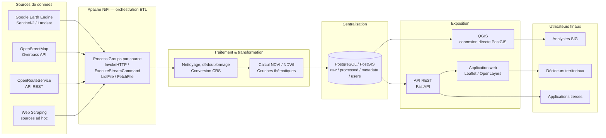

# Documentation technique — GeoSpacialData

> Document de référence du projet. Contrairement au [README.md](../README.md) (quick start,
> orienté utilisateur) et au [PLAN.md](PLAN.md) (suivi d'exécution, checkboxes), ce document
> décrit **le système dans son ensemble** : problématique, architecture cible, choix
> techniques, flux de données, schéma de base de données, sécurité, etc. Il sert de contexte
> de référence pour toute reprise du projet (nouvelle session, nouveau contributeur,
> encadrant).
>
> Source : [cahier des charges](CAHIER~2.docx) + état réel du code au moment de la rédaction.
> À maintenir à jour à chaque phase (voir [PLAN.md](PLAN.md)).

**Dernière mise à jour :** 2026-08-03

---

## 1. Vue d'ensemble

**GeoSpacialData** est un Projet de Fin d'Études (PFA, Ingénierie Informatique, 3ème année)
visant à concevoir et développer une **plateforme de collecte, centralisation, gestion et
exposition de données alternatives géospatiales**, appliquée au Maroc et au Sahara
occidental.

« Données alternatives » = données ne provenant pas des sources statistiques officielles
classiques mais de capteurs satellitaires, plateformes collaboratives, services web ou
portails ouverts : imagerie satellite (Sentinel-2, Landsat), OpenStreetMap, OpenRouteService,
web scraping ciblé.

Le projet combine architecture logicielle, data engineering et génie géomatique (GIS
Engineering).

## 2. Problématique et objectifs

### 2.1 Problématique

> Comment concevoir une plateforme unifiée, automatisée et scalable permettant de
> collecter, transformer, centraliser et diffuser des données géospatiales alternatives
> issues de sources hétérogènes, tout en garantissant la qualité, la traçabilité et
> l'exploitabilité de ces données pour des usages environnementaux et territoriaux ?

Sous-questions techniques : automatisation de la collecte multi-source sans intervention
manuelle, harmonisation de données hétérogènes (raster/vecteur/tabulaire) dans un référentiel
commun, garantie de qualité/traçabilité, stockage géospatial performant, génération de
produits dérivés (NDVI...), exposition sécurisée aux utilisateurs finaux.

### 2.2 Objectifs généraux

- Architecture logicielle modulaire et conteneurisée couvrant tout le cycle de vie de la
  donnée (acquisition → exploitation).
- Automatisation des flux d'ingestion/transformation via **Apache NiFi**.
- Centralisation dans une base spatiale **PostgreSQL/PostGIS**.
- Génération de produits géospatiaux dérivés à valeur ajoutée (NDVI et autres indices).
- Exposition via interfaces standardisées (API REST, application web, intégration QGIS).
- Portabilité et scalabilité via **Docker**.

### 2.3 Objectifs spécifiques

- Workflows NiFi automatisés pour GEE, OpenStreetMap, OpenRouteService, web scraping.
- Processeurs de transformation : conversion CRS, nettoyage, validation, normalisation.
- Calcul automatisé du NDVI (et NDWI / indices de couverture du sol) depuis Sentinel-2 /
  Landsat.
- Schéma PostgreSQL/PostGIS indexé spatialement, avec métadonnées et versionnement.
- API REST (consultation, téléchargement, requêtage spatial).
- Module de reporting / statistiques (surfaces végétalisées, évolution temporelle NDVI).
- Intégration QGIS (client de visualisation/validation, connecté à PostGIS et à l'API).
- Conteneurisation complète via Docker Compose.
- Journalisation, supervision, gestion des erreurs sur toute la chaîne.

## 3. Périmètre

### 3.1 Inclus

Pipeline complet collecte → exposition : workflows NiFi (GEE, OSM, ORS, web scraping ciblé),
transformation et calcul NDVI, schéma et administration PostGIS, API REST, interface web
minimale, intégration QGIS, conteneurisation Docker de l'ensemble.

### 3.2 Exclus

Application mobile dédiée ; classification ML avancée de l'occupation du sol (au-delà des
indices standards) ; infrastructure de calcul distribué (Spark/Hadoop) ; couverture mondiale
temps réel (zone(s) pilote(s) uniquement, Maroc + Sahara occidental) ; certification
officielle réglementaire des données produites.

## 4. Architecture cible



Chaque brique est conteneurisée (Docker Compose) : `nifi`, `gee-exporter` (contournement du
manque de connecteur GEE natif dans NiFi), `postgis` *(à créer)*, `backend` API *(à créer)*,
`frontend` web *(à créer)*.

### 4.1 Statut d'implémentation par composant

| Composant | Statut | Détail |
|---|---|---|
| Script NDVI GEE (JS, interactif) | ✅ Fonctionnel | [`gee_scripts/vegetation_cover_ndvi.js`](../gee_scripts/vegetation_cover_ndvi.js) |
| Export NDVI automatisé (pilote) | ✅ Fonctionnel | [`nifi/scripts/gee_export.py`](../nifi/scripts/gee_export.py), exécuté en boucle par [`run_loop.sh`](../nifi/scripts/run_loop.sh) |
| Conteneur NiFi | ✅ Démarre (docker-compose) | Flux NiFi (canvas) **pas encore construits/exportés** — seule la surveillance de dossier est prévue, pas encore configurée dans l'UI |
| Ingestion OSM (Overpass, InvokeHTTP) | ⏳ Non commencé | Prévu directement en processeurs NiFi, sans script dédié |
| Ingestion ORS (InvokeHTTP) | ⏳ Non commencé | Clé API prête dans `.env.example` (`ORS_API_KEY`) |
| Web scraping | ⏳ Non commencé | Aucune source ciblée définie à ce stade |
| Transformation (nettoyage, dédoublonnage, valeurs manquantes) | ⏳ Non commencé | — |
| Harmonisation CRS (EPSG:4326 / UTM) | ⏳ Non commencé | — |
| Calcul NDVI/NDWI généralisé + couches thématiques | 🔄 Partiel | NDVI fait (seuil 0.3) en GEE ; NDWI et autres indices non commencés |
| Base PostgreSQL/PostGIS | ⏳ Non commencé | Aucun service dans `docker-compose.yml` à ce jour |
| Schéma BD (raw/processed/metadata/users) | ⏳ Non commencé | Voir §9 |
| API REST | ⏳ Non commencé | Stack cible : FastAPI (voir §11) |
| Application web (Leaflet/OpenLayers) | ⏳ Non commencé | À ne pas confondre avec l'app Streamlit pluviométrie (outil exploratoire séparé) |
| Intégration QGIS | ⏳ Non commencé | — |
| App Streamlit — analyse pluviométrie IMERG | ✅ Fonctionnel | [`app.py`](../app.py) — outil complémentaire (ODD 13), hors périmètre strict du cahier des charges mais rattaché au projet |
| Authentification API / sécurité | ⏳ Non commencé | Voir §14 |
| Tests (unitaires, bout-en-bout) | ⏳ Non commencé | Aucun test dans le dépôt à ce jour |
| Réseau Docker dédié (bridge isolé) | ⏳ Non commencé | `docker-compose.yml` utilise actuellement le réseau par défaut |

Légende : ✅ fait/fonctionnel · 🔄 partiel/en cours · ⏳ pas commencé.

## 5. Flux de données de bout en bout

```
Sources (GEE, Sentinel-2/Landsat, OSM, ORS, Web Scraping)
   → Apache NiFi (collecte et orchestration)
   → Traitement et transformation (nettoyage, conversion CRS, calcul NDVI, harmonisation)
   → PostgreSQL + PostGIS (centralisation et indexation spatiale)
   → Gestion des données (métadonnées, versionnement, contrôle d'accès)
   → API REST / Application web (exposition)
   → QGIS (visualisation et analyse spatiale)
   → Utilisateurs finaux (décideurs, analystes SIG, applications tierces)
```

Justification de chaque maillon : NiFi apporte l'automatisation et la traçabilité de la
collecte multi-source ; les traitements de transformation harmonisent des données
hétérogènes par nature ; PostgreSQL/PostGIS offre un référentiel spatial centralisé,
performant et gouverné ; l'API REST et l'application web démocratisent l'accès aux données ;
QGIS complète le dispositif pour les analyses SIG avancées ; Docker garantit la portabilité
et la reproductibilité de l'ensemble.

## 6. Sources de données

| Source | Type | Format | Nature | Fréquence | Méthode de collecte | Rôle |
|---|---|---|---|---|---|---|
| Google Earth Engine | Imagerie multispectrale prétraitée | GeoTIFF (export puis récupération) | Raster | Hebdo / cycle satellite (5j Sentinel-2, 16j Landsat) | Appels API GEE (Python) déclenchés par NiFi, export vers stockage intermédiaire | Source principale pour NDVI et indices dérivés |
| Sentinel-2 / Landsat | Bandes spectrales (rouge, PIR...) | GeoTIFF | Raster | Cycle de revisite satellite | Via GEE ou téléchargement direct Copernicus/USGS en repli | Matière première du module NDVI |
| OpenStreetMap | Routes, bâtiments, occupation du sol | GeoJSON / Shapefile / PBF | Vecteur | Mensuelle ou à la demande | Overpass API ou extraits `.osm.pbf`, traités par NiFi | Référentiel vectoriel de contexte |
| OpenRouteService | Itinéraires, matrices de distance, isochrones | JSON / GeoJSON | Vecteur | À la demande | Appels REST orchestrés par NiFi | Indicateurs d'accessibilité |
| Web Scraping | Données complémentaires (météo locale, indicateurs socio-éco) | Parquet / JSON après extraction | Tabulaire | Selon la source (quotidien à mensuel) | Scripts Python (BeautifulSoup/Scrapy) en `ExecuteScript`/`ExecuteStreamCommand` NiFi | Contexte environnemental/socio-économique complémentaire |

Limites administratives (zone d'étude) : **FAO GAUL 2015 level0**, Maroc + Sahara occidental,
contour simplifié (`simplify({maxError: 1000})`) pour rester calculable en interactif.

## 7. Pipeline d'ingestion — Apache NiFi

NiFi est organisé en **Process Groups**, un par source (GEE, OSM, ORS, Web Scraping), pour
isolation logique, maintenance indépendante et supervision granulaire.

- **GEE** : NiFi n'a pas de connecteur natif → un service séparé (`gee-exporter`, basé sur
  [`gee_export.py`](../nifi/scripts/gee_export.py)) exécute périodiquement l'export NDVI
  (zone pilote, restreinte pour rester dans les limites de taille de
  `ee.Image.getDownloadURL` — cf. cahier des charges §16 "Limiter la zone d'étude pilote")
  et dépose le GeoTIFF dans `nifi/data/gee/`. NiFi surveille ensuite ce dossier via
  `ListFile`/`FetchFile` *(à configurer dans l'UI NiFi)*.
- **OSM** : processeur `InvokeHTTP` vers l'Overpass API, ou `ExecuteStreamCommand` déclenchant
  un traitement `osmium` sur un extrait régional. Résultats dans `nifi/data/osm/`.
- **ORS** : processeur `InvokeHTTP` avec requêtes REST paramétrées (clé API dans
  `ORS_API_KEY`). Résultats dans `nifi/data/ors/`.
- **Web Scraping** : `ExecuteStreamCommand` exécutant un script dédié par source (à définir).

Planification : `cron-driven` pour les tâches périodiques (quotidien/hebdo), `timer-driven`
pour les vérifications régulières.

Chaîne ETL standard par flux : validation du format reçu → extraction de métadonnées
(date, zone, source) → routage conditionnel (`RouteOnAttribute`) → transformation (§8) →
écriture finale en base via `PutDatabaseRecord`/`PutSQL`.

Journalisation : nativement assurée par NiFi (provenance, logs), complétée par
`LogAttribute`. Supervision via l'UI NiFi (Data Provenance, Bulletin Board), alertes
optionnelles via `PutEmail`/webhook. Gestion des erreurs : relations `failure` de chaque
processeur → files d'attente dédiées avec réessai (backoff) avant notification d'échec
définitif.

**Accès local :** `http://localhost:8080/nifi` (voir `docker-compose.yml`).

## 8. Traitement et transformation

- **Validation** : intégrité des fichiers reçus (GeoTIFF lisible, GeoJSON valide) → rejet
  des fichiers corrompus vers une file d'erreurs.
- **Nettoyage** : correction des incohérences (géométries invalides, encodages).
- **Dédoublonnage** : clés naturelles (id OSM, couple date/zone pour images satellites).
- **Valeurs manquantes** : règles par type de donnée (interpolation, exclusion, marquage
  explicite en base).
- **Métadonnées** : source, date d'acquisition, système de projection, résolution, licence.
- **Conversion CRS** : harmonisation vers **EPSG:4326** (échange) et **EPSG:326xx UTM**
  (calculs métriques locaux), via GDAL/PROJ.
- **Conversion de format** : GeoTIFF (raster), GeoJSON/Shapefile (vecteur), Parquet
  (tabulaire).
- **Découpage spatial (clip)** et **filtrage spatial** sur l'emprise de la zone d'étude.
- **Jointures spatiales** : croisement OSM (vecteur) × NDVI (raster) pour statistiques
  zonales.

### 8.1 Calcul du NDVI

```
NDVI = (NIR − Rouge) / (NIR + Rouge)
```

Appliqué pixel par pixel sur les bandes PIR (B8) et Rouge (B4) de Sentinel-2, via
`normalizedDifference(['B8', 'B4'])` côté serveur GEE (implémentation actuelle) ou via
`rasterio`/`numpy` en local (à envisager si le calcul doit sortir de GEE). Seuillage actuel :
`NDVI > 0.3` → masque binaire végétation.

D'autres indices (**NDWI** pour l'eau, indices de couverture du sol) suivent le même
principe et restent à implémenter (voir [PLAN.md](PLAN.md) Phase 4).

Détail ligne par ligne du script actuel : voir [README.md](../README.md#explication-du-script-ligne-par-ligne--vegetation_cover_ndvijs).

## 9. Centralisation — PostgreSQL/PostGIS *(à implémenter)*

### 9.1 Schémas logiques prévus

| Schéma | Contenu |
|---|---|
| `raw` | Données brutes horodatées, telles que collectées |
| `processed` | Données transformées (NDVI, couches thématiques) |
| `metadata` | Documentation des jeux de données (source, licence, date, CRS, résolution, lien vers fichier/objet raster) |
| `users` | Gestion des accès |

### 9.2 Points clés de conception

- Stockage de géométries (points/lignes/polygones) et de rasters (extension raster PostGIS
  ou stockage hybride fichier + référence en base).
- Requêtes spatiales en SQL (intersections, tampons, jointures spatiales).
- Nomenclature normalisée des jeux de données : `source_type_zone_date`.
- Table de métadonnées centralisée référençant chaque dataset.
- **Indexation spatiale** : index GiST sur les colonnes géométriques.
- **Versionnement** : couple (identifiant logique, numéro de version, date de génération) —
  ne jamais écraser une donnée précédente.
- **Rôles PostgreSQL** (principe du moindre privilège) : lecture seule pour les
  consommateurs, écriture restreinte pour les pipelines NiFi, administrateur pour la
  maintenance.
- **Sauvegardes** : `pg_dump`/`pg_basebackup` planifiées, volume Docker persistant dédié,
  rotation des sauvegardes.
- **Intégrité** : contraintes SQL (clés primaires, `ST_IsValid` pour la validité
  géométrique).
- **Performance** : partitionnement des tables volumineuses par zone/période, tuning
  PostgreSQL (mémoire, cache, parallélisme).

## 10. Exposition — API REST / Application web / QGIS *(à implémenter)*

- **API REST** (stack cible : FastAPI) — endpoints prévus : liste des jeux de données
  disponibles + métadonnées, requêtage spatial (filtrage zone/date/type d'indice),
  téléchargement (GeoTIFF, GeoJSON, Shapefile, Parquet), réponses JSON. Documentation
  OpenAPI/Swagger.
- **Application web** (Leaflet ou OpenLayers) — visualisation cartographique des couches
  NDVI/thématiques, tableaux de bord de statistiques synthétiques.
- **QGIS** — connexion directe à PostGIS (couche PostGIS dans QGIS), ou via endpoints API
  (WFS/WMS si serveur cartographique complémentaire ajouté en option).
- **Reporting** : génération de rapports PDF/HTML périodiques (état de végétation d'une
  zone donnée).

> Ne pas confondre avec l'app Streamlit actuelle ([`app.py`](../app.py)) : c'est un
> prototype exploratoire pour la pluviométrie IMERG, distinct de l'application web cible
> du cahier des charges (Leaflet/OpenLayers, branchée sur l'API REST + PostGIS).

## 11. Stack technologique

| Techno | Rôle | Justification |
|---|---|---|
| **Google Earth Engine** | Catalogue + calcul cloud d'imagerie satellite | Accès gratuit (usage académique) à un catalogue mondial prétraité, calcul côté serveur |
| **Apache NiFi** | Orchestration ETL | UI graphique de conception de flux, provenance native (traçabilité), extensible par scripts externes |
| **PostgreSQL + PostGIS** | Centralisation spatiale | Robustesse, licence open source, écosystème spatial de référence (vecteur + raster) |
| **QGIS** | Client SIG | Visualisation, validation visuelle, analyse spatiale avancée, sans coût de licence |
| **Docker / Docker Compose** | Conteneurisation | Reproductibilité, portabilité, démonstration facilitée en soutenance |
| **OpenStreetMap** | Données vectorielles de référence | Gratuit, mondial, mis à jour communautairement |
| **OpenRouteService** | Routage / accessibilité | S'appuie sur OSM, gratuit pour usage académique |
| **Web scraping (Python)** | Sources sans API officielle | Complète les API officielles pour les données réellement "alternatives" |
| **Streamlit** *(complémentaire)* | Prototype interactif pluviométrie | Développement rapide d'une UI d'exploration (hors périmètre API/web cible) |
| **FastAPI** *(cible, à confirmer)* | API REST | Performance, typage, génération auto OpenAPI/Swagger |

Exclus volontairement (cahier des charges §14) : Spark/Hadoop (traitement distribué),
Kafka/RabbitMQ (files de messages) — jugés disproportionnés pour le volume traité dans le
cadre d'un PFA.

## 12. Structure du dépôt

```
GeoSpacialData/
├── README.md                     # Quick start + détail du script NDVI
├── requirements.txt              # Dépendances Python (app Streamlit)
├── app.py                        # App Streamlit — analyse pluviométrique (IMERG)
├── 02_Atelier_GEE_...ipynb       # Notebook exploratoire (prototype de app.py)
├── docker-compose.yml            # Services NiFi + gee-exporter (PostGIS/backend/frontend à ajouter)
├── .env.example                  # Variables d'environnement (à copier en .env)
├── .gitignore
├── gee_scripts/
│   └── vegetation_cover_ndvi.js  # Script GEE — couverture végétale (ODD 15)
├── nifi/
│   ├── data/{gee,osm,ors}/       # Dossiers surveillés par NiFi (dépôt intermédiaire)
│   └── scripts/
│       ├── gee_export.py         # Export NDVI automatisé (zone pilote)
│       ├── run_loop.sh           # Boucle d'exécution périodique
│       ├── Dockerfile
│       └── requirements.txt
└── documentation/
    ├── CAHIER~2.docx             # Cahier des charges (source de vérité du besoin)
    ├── TECHNICAL.md              # Ce document
    ├── ROADMAP.md                # Vue d'ensemble des phases
    └── PLAN.md                   # Suivi d'exécution détaillé (checkboxes)
```

*(À ajouter au fil du projet : `backend/`, `frontend/`, `db/` (schéma SQL, migrations),
`qgis_projects/`, `tests/`.)*

## 13. Variables d'environnement

Référence : [`.env.example`](../.env.example).

| Variable | Rôle | Utilisée par |
|---|---|---|
| `EE_PROJECT_ID` | ID du projet Google Cloud associé à Earth Engine | `app.py`, `nifi/scripts/gee_export.py` |
| `EE_CONFIG_DIR` | Dossier des credentials Earth Engine (`earthengine authenticate`) | Service `gee-exporter` (docker-compose, monté en volume) |
| `GEE_INTERVAL_HOURS` | Fréquence de l'export NDVI automatique (défaut 24h) | `run_loop.sh` |
| `GEE_LOOKBACK_DAYS` | Fenêtre temporelle de l'export NDVI (défaut 14 jours) | `gee_export.py` |
| `ORS_API_KEY` | Clé API OpenRouteService | Processeur `InvokeHTTP` NiFi (flux ORS, à configurer) |

*(À compléter en Phase 5/6 : identifiants PostgreSQL, secrets API REST, etc. — jamais en
dur dans le code, toujours via variables d'environnement ou secrets Docker, cf. §14.)*

## 14. Sécurité

- Accès API REST protégé par authentification (clé API ou JWT), distinguant au minimum
  lecture seule / administration.
- Identifiants (PostgreSQL, GEE, ORS) en variables d'environnement / secrets Docker, jamais
  en dur dans le code source.
- Communications frontend/backend/utilisateur chiffrées (HTTPS) en production.
- Rôles PostgreSQL appliquant le principe du moindre privilège.
- Journaux d'accès et d'erreurs conservés pour audit a posteriori.
- Web scraping : respect des `robots.txt` et des CGU des sites sources, limitation de la
  fréquence des requêtes.

## 15. Exigences non fonctionnelles

| Axe | Exigence |
|---|---|
| Performance | Workflows d'ingestion planifiés sans dégradation notable des temps de réponse de l'API ; NDVI sur zone standard (qq centaines de km²) en temps raisonnable, mise à jour hebdo |
| Fiabilité | Chaque étape NiFi gère les erreurs avec réessais automatiques et notification en cas d'échec persistant, sans interrompre le reste du pipeline |
| Disponibilité | Services conteneurisés avec politique de redémarrage automatique Docker |
| Maintenabilité | Architecture modulaire, documentée, versionnée (Git), composants évolutifs indépendamment |
| Scalabilité | Ajout de nouvelles zones/sources sans refonte majeure du schéma ou de l'architecture |
| Utilisabilité | API documentée (OpenAPI/Swagger), interface web simple pour utilisateur non-développeur |
| Portabilité | Déploiement identique sur toute machine disposant de Docker |

## 16. Contraintes et hypothèses

**Contraintes** : outils exclusivement open source / offres gratuites académiques (pas de
budget licences commerciales) ; machine de dev suffisamment puissante pour NiFi + PostgreSQL
+ services applicatifs en simultané ; projet mené en effectif restreint (individuel/binôme) ;
calendrier académique typique 4–6 mois.

**Hypothèses** : compte GEE académique validé ; zone(s) d'étude pilote(s) stables sur toute
la durée du projet ; API tierces (Overpass, ORS) disponibles et gratuites pendant la durée
du projet ; machine avec ≥ 8 Go RAM (16 Go idéalement) et espace disque suffisant pour les
rasters ; volumétrie compatible avec une architecture mono-serveur.

## 17. Analyse des risques

| Risque | Probabilité | Impact | Mitigation |
|---|---|---|---|
| Indisponibilité / changement de quotas GEE | Moyenne | Élevé | Mode de repli : téléchargement direct Copernicus/USGS |
| Instabilité des API tierces (Overpass, ORS) | Moyenne | Moyen | Réessais + mise en cache locale des résultats |
| Volumétrie dépassant les capacités matérielles | Moyenne | Élevé | Limiter la zone d'étude pilote, prévoir un partitionnement |
| Hétérogénéité des CRS → erreurs de superposition | Élevée | Élevé | Standardiser la conversion CRS dès l'ingestion |
| Blocage/évolution des sites scrapés | Moyenne | Moyen | Scripts modulaires, cibler les sources les plus stables |
| Retard calendaire académique | Moyenne | Moyen | Jalons intermédiaires + marges de sécurité (voir [PLAN.md](PLAN.md)) |
| Complexité d'intégration NiFi ↔ PostGIS ↔ API | Moyenne | Moyen | Prototypage précoce d'une chaîne bout-en-bout minimale (MVP) avant extension |
| Non-respect des CGU des sources scrapées | Faible | Moyen | Vérification systématique `robots.txt` / CGU avant intégration |

## 18. Critères de validation et d'acceptation

Le projet est considéré comme validé si :

- Au moins un flux NiFi complet fonctionne de bout en bout pour **chaque** source (GEE, OSM,
  ORS, web scraping), de la collecte à l'insertion en base.
- Le calcul NDVI est fonctionnel, cohérent, et visuellement validé sur QGIS pour la zone
  pilote.
- La base PostgreSQL/PostGIS est correctement structurée, indexée et documentée.
- L'API REST expose au minimum consultation, requêtage spatial, téléchargement — avec
  documentation associée.
- L'ensemble se déploie via **une seule commande** `docker compose up` sur une machine
  tierce.
- La traçabilité (logs, métadonnées) permet de reconstituer l'origine et l'historique de
  chaque jeu de données.
- Le rapport de PFA documente fidèlement architecture, choix techniques et résultats.

## 19. Livrables attendus

Rapport de PFA (incluant le cahier des charges, l'analyse de conception, le bilan) ; code
source complet versionné (flux NiFi exportés, scripts de transformation, backend API,
frontend, schéma de base de données) ; fichiers Docker Compose / Dockerfile pour déploiement
complet ; documentation technique (architecture, schéma BD, doc API OpenAPI) ; jeu de
données de démonstration (zone pilote entièrement traitée, NDVI + couches thématiques) ;
projets QGIS préconfigurés ; présentation de soutenance.

## 20. Perspectives d'évolution

Classification supervisée/non supervisée pour cartographie automatisée de l'occupation du
sol ; serveur cartographique dédié (GeoServer/MapServer, standards OGC WMS/WFS) en
complément optionnel de l'API REST ; extension à d'autres indices environnementaux (NDWI,
stress hydrique) ; infrastructure multi-nœuds si la volumétrie croît significativement
(hors cadre raisonnable d'un PFA) ; application mobile de terrain pour la remontée
d'observations (ground truthing).

## 21. Glossaire

| Terme | Définition |
|---|---|
| **NDVI** | Normalized Difference Vegetation Index — indice de végétation = (PIR − Rouge)/(PIR + Rouge) |
| **NDWI** | Normalized Difference Water Index — indice équivalent pour l'eau |
| **CRS** | Coordinate Reference System — système de référence de coordonnées (ex. EPSG:4326) |
| **PostGIS** | Extension spatiale de PostgreSQL (géométries, rasters, requêtes spatiales) |
| **ROI** | Region Of Interest — zone d'étude |
| **GiST** | Generalized Search Tree — type d'index utilisé pour l'indexation spatiale en PostgreSQL |
| **ETL** | Extract-Transform-Load — chaîne d'extraction/transformation/chargement de données |
| **ODD** | Objectifs de Développement Durable (SDG en anglais) |
| **IMERG** | Integrated Multi-satellitE Retrievals for GPM — produit de précipitation NASA |
| **PFA** | Projet de Fin d'Études |

## 22. Références

- Cahier des charges complet : [`documentation/CAHIER~2.docx`](CAHIER~2.docx)
- [README.md](../README.md) — quick start, détail ligne par ligne du script NDVI
- [ROADMAP.md](ROADMAP.md) — vue d'ensemble des phases
- [PLAN.md](PLAN.md) — suivi d'exécution détaillé, checkboxes, scénarios de test
- [Google Earth Engine](https://earthengine.google.com/)
- [Apache NiFi](https://nifi.apache.org/)
- [PostGIS](https://postgis.net/)
- [QGIS](https://qgis.org/)
- [OpenStreetMap / Overpass API](https://wiki.openstreetmap.org/wiki/Overpass_API)
- [OpenRouteService](https://openrouteservice.org/)
