# Multi-Source Geospatial Data Platform — Design & Architecture

**Scope:** host many datasets from heterogeneous sources (REST/OGC APIs, satellite imagery, web pages, files, databases, streams), give each source class its own ingestion pipeline, land everything in an open lakehouse, and expose geospatial assets through spatial libraries and map services for downstream processing.

**Constraint applied throughout:** open-source, production-stable components only. Where a technology is young, it is flagged and a fallback is given.

---

## 1. Prior art — this pattern already exists

You are not designing something novel in shape. Several public systems implement almost exactly this architecture, and most of them publish their code. Study these before writing a line.

### 1.1 The closest full-system references


| System                                       | What it is                                                                    | Why it matters to you                                                                                                                          | Where                            |
| -------------------------------------------- | ----------------------------------------------------------------------------- | ---------------------------------------------------------------------------------------------------------------------------------------------- | -------------------------------- |
| **eoAPI** (Development Seed)                 | Packaged, deployable bundle of `stac-fastapi` + `pgstac` + `titiler` + `tipg` | The single most directly reusable artifact. This *is* the catalog + raster tiles + vector features stack, ready to deploy                      | github.com/developmentseed/eoAPI |
| **Microsoft Planetary Computer**             | Petabyte EO catalog + API + compute hub on Azure Blob                         | Architecture blueprint: STAC catalog, dynamic tiling, JupyterHub compute. Components are open source even though the deployment is not         | planetarycomputer.microsoft.com  |
| **Open Data Cube (ODC)**                     | `datacube-core`, `odc-stac`, `datacube-explorer`                              | The reference implementation for turning EO scenes into analysis-ready `xarray` cubes. Powers national-scale platforms                         | opendatacube.org                 |
| **Digital Earth Africa / Australia**         | National/continental ODC deployments                                          | Proven operational patterns at country scale, fully open, with published deployment repos                                                      | digitalearthafrica.org           |
| **EOEPCA+** (ESA)                            | Earth Observation Exploitation Platform Common Architecture                   | A *reference architecture* with building blocks (resource catalog, processing, workspace, IAM). Read this for the governance/IAM decomposition | eoepca.readthedocs.io            |
| **Copernicus Data Space Ecosystem / openEO** | EU-scale EO access + a standard processing API                                | `openEO` is the standard to adopt if you ever want portable, engine-agnostic geo-processing jobs                                               | openeo.org                       |
| **DestinE Data Lake (DEDL)**                 | EU "digital twin" data lake, EUMETSAT-operated                                | Closest analogue to a multi-modal (not EO-only) geo data lake with federated access                                                            | destination-earth.eu             |
| **Pangeo**                                   | Community stack: Zarr + Xarray + Dask + JupyterHub                            | The array/climate-science half of your platform. Not a product, a proven composition                                                           | pangeo.io                        |
| **Source Cooperative / Overture Maps**       | Cloud-native geodata distribution on S3                                       | Pattern reference for publishing GeoParquet/PMTiles to the public                                                                              | source.coop, overturemaps.org    |


### 1.2 What none of them give you

- **Non-geo sources as first-class citizens.** ODC/STAC platforms assume EO. Your requirement includes generic APIs and web scraping, which belong in a lakehouse, not a STAC catalog.
- **A unified table format across modalities.** Most EO platforms have no Iceberg layer at all.
- **A single ingestion framework** covering scrape, API pull, CDC and scene ingest under one contract.

So: **compose, don't invent.** Take eoAPI for the geo serving plane, a standard Iceberg lakehouse for the tabular plane, and write only the thin ingestion framework that unifies them.

---


## 2. Design principles

1. **One substrate, several physical formats.** Object storage is the single substrate. Do *not* force rasters into Iceberg or force tabular data into GeoTIFF. Modality decides format; the catalog layer hides the difference.
2. **Separate the three catalogs.** Table catalog ≠ spatial/discovery catalog ≠ business metadata catalog. Conflating them is the most common failure in this design.
3. **Ingestion is a plugin, not a fork.** Every connector implements the same contract (manifest → bronze → event → lineage). Adding a source type must not mean a new architecture.
4. **Metadata is written by the pipeline, never by a human afterwards.** If a step can't emit its lineage and quality metrics, it isn't finished.
5. **Cloud-optimised by default.** Every stored asset must be range-readable over HTTP: COG, GeoParquet, Zarr, PMTiles. No monolithic non-seekable files in the serving path.
6. **Compute is disposable, storage is durable.** Engines (Trino, Spark, DuckDB) are interchangeable readers of one open storage layer.

---


## 3. Reference architecture

```mermaid
flowchart TB
  subgraph SRC["Sources"]
    A1["REST / OGC APIs"]
    A2["Satellite imagery<br/>(STAC, SciHub, direct)"]
    A3["Web pages / documents"]
    A4["Files<br/>(SHP, GPKG, CSV, NetCDF)"]
    A5["Databases (CDC)"]
    A6["Streams / sensors / IoT"]
  end

  subgraph ING["Ingestion plane — Dagster-orchestrated connectors"]
    B1["dlt<br/>API extractor"]
    B2["pystac-client +<br/>GDAL / rio-cogeo"]
    B3["Scrapy / Playwright<br/>+ trafilatura"]
    B4["GDAL/OGR<br/>normaliser"]
    B5["Debezium → Kafka"]
    B6["Flink / RisingWave"]
  end

  subgraph STORE["Storage plane — S3 API object store (MinIO / Ceph / S3)"]
    C0["RAW zone<br/>byte-faithful originals + WARC"]
    C1["Iceberg v3 tables<br/>(Parquet / GeoParquet 2.0)"]
    C2["COG assets<br/>+ STAC items"]
    C3["Zarr v3 datacubes<br/>(GeoZarr conventions)"]
    C4["PMTiles<br/>serving artifacts"]
  end

  subgraph CAT["Catalog plane"]
    D1["Lakekeeper / Polaris<br/>(Iceberg REST catalog)"]
    D2["pgstac + stac-fastapi<br/>(spatiotemporal discovery)"]
    D3["OpenMetadata<br/>(glossary, lineage, quality)"]
  end

  subgraph PROC["Processing plane"]
    E1["Trino — federated SQL"]
    E2["Spark + Apache Sedona<br/>— large-scale spatial"]
    E3["DuckDB + spatial<br/>— interactive / single-node"]
    E4["Xarray + Dask + odc-stac<br/>— raster cubes"]
    E5["JupyterHub / notebooks"]
  end

  subgraph SERVE["Serving & rendering plane"]
    F1["TiTiler + titiler-pgstac<br/>dynamic raster tiles"]
    F2["Martin / tipg<br/>vector tiles + OGC Features"]
    F3["pygeoapi<br/>OGC API Processes"]
    F4["MapLibre GL JS + deck.gl<br/>+ STAC Browser"]
  end

  SRC --> ING --> STORE
  STORE --- CAT
  CAT --> PROC
  STORE --> PROC
  PROC --> SERVE
  STORE --> SERVE

  subgraph GOV["Cross-cutting"]
    G1["Keycloak OIDC + OPA/OpenFGA"]
    G2["OpenLineage / Marquez"]
    G3["Soda Core / Great Expectations"]
    G4["Prometheus + Grafana + Loki"]
  end
```




---


## 4. Storage layer — format decision matrix

**Substrate:** an S3-API object store. Self-hosted: **MinIO** (simple, single-binary, well understood) or **Ceph RGW** (if you also need block/file and multi-petabyte erasure coding). Managed: AWS S3. The point is the *API*, not the vendor — every component below speaks S3.

**Table format: Apache Iceberg.** This question is settled in 2026; Iceberg has won the open-table-format contest and has the broadest engine support (Trino, Spark, Flink, DuckDB, StarRocks, Dremio, ClickHouse).


| Data modality                                                        | Format                                    | Table format                                               | Rationale                                                                             |
| -------------------------------------------------------------------- | ----------------------------------------- | ---------------------------------------------------------- | ------------------------------------------------------------------------------------- |
| Tabular, non-spatial                                                 | Parquet                                   | **Iceberg v3**                                             | ACID, schema evolution, time travel, hidden partitioning                              |
| Vector geospatial (points/lines/polygons)                            | **GeoParquet 2.0**                        | **Iceberg v3** with `geometry`/`geography` columns         | Native spatial types + bbox statistics in manifests enable file-level spatial pruning |
| Raster / EO scenes                                                   | **COG** (Cloud-Optimized GeoTIFF)         | *not* an Iceberg table — object assets indexed by **STAC** | Range requests + internal overviews; putting pixels in Parquet is an anti-pattern     |
| N-dimensional / time-series cubes (climate, reanalysis, NDVI stacks) | **Zarr v3** with **GeoZarr** conventions  | STAC item pointing at the store                            | Chunked, parallel-writable, native to Xarray/Dask                                     |
| Point clouds                                                         | COPC (Cloud-Optimized Point Cloud) or LAZ | STAC                                                       | PDAL toolchain                                                                        |
| Web pages / documents (raw)                                          | **WARC** + original bytes                 | RAW zone, no table                                         | Provenance and reprocessability                                                       |
| Web-extracted structured data                                        | Parquet                                   | **Iceberg v3**                                             | Becomes a normal table after parsing                                                  |
| Pre-rendered map tiles                                               | **PMTiles**                               | serving artifact, not a table                              | Single-file tile archive served directly from object storage, no tile server needed   |


### 4.1 Zone model

```
s3://platform/
  raw/<source_id>/<ingest_date>/…          # immutable, byte-faithful, WORM policy
  bronze/<domain>/<dataset>/               # Iceberg — parsed, typed, still source-shaped
  silver/<domain>/<dataset>/               # Iceberg — conformed, deduped, CRS-normalised
  gold/<product>/                          # Iceberg — analysis-ready products, indicators
  assets/cog/<collection>/…                # COG rasters
  assets/zarr/<collection>.zarr/           # datacubes
  serving/pmtiles/<layer>.pmtiles          # tiles
```


### 4.2 One important caveat on Iceberg geospatial types

Iceberg v3 introduced native `geometry` and `geography` primitive types (WKB on disk, WKT in JSON metadata, bounding-box statistics recorded in manifests so engines can skip whole files before reading a geometry). Parquet gained matching `GEOMETRY`/`GEOGRAPHY` logical types, and GeoParquet 2.0 is built on them.

**But engine support is uneven as of mid-2026.** Reading a table, understanding the geometry type, evaluating spatial predicates and actually doing manifest-based pruning are four separate rungs on a ladder, and engines sit on different rungs.

**Practical recommendation:** design the schema for v3 geo types, but ship with the **V2 bridge pattern** in parallel until you have verified your specific engine matrix end-to-end:

- store geometry as a `binary` WKB column,
- carry explicit `bbox_minx/miny/maxx/maxy` columns,
- partition/sort by an H3 or S2 cell ID (or Hilbert curve) for spatial locality,
- record CRS in table properties.

This costs a few columns and works everywhere today. Migrate to native types per-table once your engines clear the bar. Apache Sedona already reads and writes Iceberg geo columns, so a Sedona-centric path can go native earlier than a Trino-centric one.

### 4.3 What about DuckLake?

DuckLake (metadata in a SQL database rather than in manifest files) is elegant and much simpler operationally. It is also young. Use it for departmental sandboxes and local development; do not make it the institutional system of record yet.

---


## 5. Catalog layer — three catalogs, three jobs

This is the part most designs get wrong. Keep them separate and let them cross-reference by stable IDs.

### 5.1 Table catalog (technical)

**Recommendation: Lakekeeper.** Rust, single binary, no JVM, OIDC-native, authorization via OpenFGA/OPA, minimal operational footprint — a good fit for a self-hosted, Kubernetes or Compose deployment.

**Alternative: Apache Polaris**, which graduated to a top-level Apache project in February 2026 and is the vendor-neutral community standard with the broadest engine interoperability. Choose Polaris if you expect many external engines, or organisational pressure toward "the ASF standard"; choose Lakekeeper if you value a lean footprint and fine-grained authz.

Both implement the Iceberg REST protocol, so this decision is reversible.

**Enable credential vending, and prefer remote signing for sensitive collections** — with remote signing the query engine never holds a broad token; the catalog pre-signs each individual file read, scoped to one file and one operation. That matters when the lake holds restricted data.

### 5.2 Spatial/discovery catalog

**Recommendation:** `pgstac` **+** `stac-fastapi`**.** STAC is the de facto standard for spatiotemporal asset discovery, `pgstac` is the PostgreSQL schema that makes it scale to hundreds of millions of items, and `stac-fastapi` is the API in front. Add the `stac-fastapi-pgstac` backend plus the **Filter (CQL2)**, **Sort**, **Query** and **Transaction** extensions.

Every ingested asset — COG, Zarr store, *and* Iceberg table snapshot — gets a STAC Item or Collection. The Item's `assets` block points at the physical location; for a table the asset href is the catalog table identifier. This gives you **one spatiotemporal search surface across all modalities**, which is the single most valuable property of the whole design.

Front it with **STAC Browser** for human discovery.

### 5.3 Business/governance catalog

**Recommendation: OpenMetadata** (alternative: DataHub). Glossary, ownership, classification, data contracts, quality results, and column-level lineage ingested via **OpenLineage** emitters from the orchestrator. This is where non-engineers find out what a dataset means.

---


## 6. Ingestion framework


### 6.1 The common contract

Every connector, regardless of source type, is defined by a **declarative manifest** and produces the same five outputs.

```yaml
# datasets/copernicus_s2_l2a.yaml
id: copernicus_s2_l2a
title: Sentinel-2 L2A surface reflectance
source:
  type: stac_api              # rest_api | stac_api | web | file_drop | cdc | stream
  endpoint: https://stac.dataspace.copernicus.eu/v1
  collections: [sentinel-2-l2a]
  auth: keycloak_client:copernicus
extract:
  mode: incremental
  cursor: properties.datetime
  spatial_filter: aoi/national_boundary.geojson
  schedule: "0 3 * * *"
target:
  modality: raster
  format: cog
  zone: assets/cog/sentinel-2-l2a
  stac_collection: sentinel-2-l2a
quality:
  checks: [checksum, crs_present, nodata_declared, cloud_cover_range]
governance:
  owner: eo_team
  classification: public
  license: CC-BY-4.0
  retention: permanent
```

**The five mandatory outputs of any pipeline run:**

1. **Raw artifact** persisted immutably in `raw/` with checksum.
2. **Normalised asset** in the modality-appropriate format and zone.
3. **Catalog registration** — Iceberg table commit and/or STAC item upsert.
4. **Lineage event** (OpenLineage) — inputs, outputs, code version, run ID.
5. **Quality report** — assertions run, passed/failed, row/pixel counts.

A run that produces 1–2 but not 3–5 is a failed run. Enforce this in the framework, not in reviews.

### 6.2 Orchestration

**Recommendation: Dagster.** Its asset-centric model (you declare *datasets* and their dependencies, not *tasks*) maps directly onto a catalog of hundreds of heterogeneous datasets, and it has first-class data-quality checks, partitioned assets (by date and by tile), and native lineage.

**Alternative: Apache Airflow 3.x** if your team already runs it and you want the larger operator ecosystem. Airflow's asset-aware scheduling closed much of the gap, but Dagster remains the better conceptual fit here.

Heavy compute is **submitted**, not executed, by the orchestrator: Dagster launches Spark/Sedona jobs and Dask clusters on Kubernetes and tracks them.

### 6.3 Pipeline per source type


#### (a) REST / GraphQL / OGC APIs

```
dlt source (paginated, incremental, auth via Keycloak)
  → schema inference + contract check
  → pyiceberg / Spark write → bronze Iceberg table
  → dbt or SQLMesh transforms → silver/gold
```

**Why dlt:** declarative Python extractors, automatic schema evolution, incremental cursors, native Iceberg destination. Handles the long tail of "yet another JSON API" without a new codebase each time.
Alternative for the very long tail of SaaS connectors: **Airbyte** (heavier, but 300+ prebuilt sources).
For OGC API-Features/WFS specifically: `OWSLib` / GDAL's `OAPIF` driver → GeoParquet → Iceberg.

#### (b) Satellite imagery

```
pystac-client search (bbox + datetime + cloud cover)
  → asset download (or streaming read via /vsicurl/)
  → GDAL / rio-cogeo: reproject, tile, build overviews → validated COG
  → rio-cogeo validate + checksum
  → PgSTAC upsert (item + assets + proj: and eo: extensions)
  → [optional] odc-stac / stackstac → Zarr datacube for time-series products
```

Key decisions:

- **Do not re-tile the world.** Keep source COGs; derive products, don't duplicate archives.
- **Cube only what you analyse repeatedly.** Zarr datacubes are expensive to maintain; build them for specific AOIs and specific analyses (e.g. a 10-year NDVI stack for the national territory), not speculatively.
- **Reprojection policy:** keep native CRS in `assets/`, standardise CRS in derived products only. Record CRS explicitly everywhere — with `proj:` STAC extension for rasters, table properties for Iceberg.
- For sources without STAC (older archives, national providers), write a small **STAC-ification step** that generates items from filenames/sidecars. `rio-stac` and `stactools` do most of this.


#### (c) Web pages

```
Scrapy (static) or Playwright (JS-rendered)
  → robots.txt compliance + rate limiting + polite UA
  → WARC archive → raw/ zone (this is your evidence trail)
  → trafilatura / selectolax extraction → structured records
  → optional LLM structuring for messy pages (validated against a JSON schema)
  → geocoding (Nominatim self-hosted / Pelias) → geometry column
  → bronze Iceberg table
```

Non-negotiables: store the raw WARC (so re-parsing never means re-crawling), record the crawl timestamp and the exact selector/parser version in lineage, and keep a `parse_confidence` column. Web data is the least trustworthy input in the platform and must be labelled as such in the governance catalog.

Geocoded records need an explicit **geocoding quality** field — never let an approximate centroid silently join a precise cadastral analysis.

#### (d) File drops (SHP, GPKG, GeoJSON, CSV, NetCDF, KML)

```
Watched prefix in object storage / upload API
  → GDAL/OGR introspection (geometry type, CRS, encoding)
  → ogr2ogr → GeoParquet 2.0 (or netCDF → Zarr for gridded)
  → CRS validation and normalisation
  → Iceberg table (vector) or Zarr + STAC (gridded)
```

Add an **encoding-detection step** for legacy shapefiles (`.cpg` is frequently missing or wrong) and a hard failure if CRS is undeclared. Silent CRS assumptions are the single most expensive class of bug in geospatial platforms.

#### (e) Operational databases (CDC)

```
Debezium → Kafka/Redpanda → Kafka Connect Iceberg sink
   (or: Flink CDC → Iceberg)
  → bronze Iceberg with `_op`, `_ts_ms`, `_source_lsn`
  → MERGE INTO silver (Iceberg v3 deletion vectors handle upserts efficiently)
```


#### (f) Streams / sensors / IoT

```
MQTT / Kafka → Flink SQL or RisingWave
  → windowed aggregation, geofencing, H3 indexing
  → Iceberg sink with small-file compaction enabled
```

Set up **automatic compaction and snapshot expiry** from day one for streaming tables, or you will drown in small files within weeks.

---


## 7. Processing layer

Four engines, four distinct jobs. Do not try to standardise on one.


| Engine                                                | Role                                                    | When to use                                                                                            |
| ----------------------------------------------------- | ------------------------------------------------------- | ------------------------------------------------------------------------------------------------------ |
| **Trino**                                             | Federated SQL across Iceberg + PostGIS + object storage | Interactive analytics, joins across datasets, BI backend                                               |
| **Apache Spark + Apache Sedona**                      | Distributed spatial processing                          | Large joins, spatial partitioning, raster–vector zonal statistics at scale, writing Iceberg geo tables |
| **DuckDB +** `spatial` **+** `iceberg` **extensions** | Single-node interactive                                 | Analyst workflows, notebooks, anything under ~100 GB. Often 10× more productive than a cluster         |
| **Xarray + Dask +** `odc-stac` **/** `stackstac`      | N-dimensional raster                                    | Time-series, climate, index computation over image stacks                                              |


**Transformation framework:** **dbt-core** (with `dbt-trino` or `dbt-duckdb`) or **SQLMesh** for the bronze→silver→gold SQL layer, version-controlled and tested.

**User-facing compute:** **JupyterHub** on Kubernetes, with images preloaded for `geopandas`, `rasterio`, `xarray`, `pystac-client`, `odc-stac`, `duckdb`, `sedona`, `leafmap`. Mount the object store read-only by default; writes go through the catalog.

**Optional but valuable:** expose an **openEO** endpoint. It gives users a standard, engine-portable process graph API for EO workflows, and it means your platform is interchangeable with Copernicus and other openEO backends.

---


## 8. Geospatial serving and rendering layer

This addresses "geospatial datasets rendered in a geo library to allow further processing". Two distinct needs — **visual rendering** and **programmatic loading** — are served differently.

### 8.1 Visual rendering (map surfaces)


| Need                          | Component                            | Notes                                                                                                                |
| ----------------------------- | ------------------------------------ | -------------------------------------------------------------------------------------------------------------------- |
| Dynamic raster tiles from COG | **TiTiler**                          | On-the-fly rescaling, band math, colormaps; no pre-rendering                                                         |
| Mosaics over many scenes      | **titiler-pgstac**                   | Renders a mosaic straight from a STAC search — extremely powerful                                                    |
| Vector tiles, dynamic         | **Martin** (Rust) or **pg_tileserv** | Serves MVT from PostGIS and from PMTiles archives                                                                    |
| Vector tiles, static & large  | **tippecanoe → PMTiles**             | Generate once, serve directly from object storage over HTTP range requests. No tile server, no scaling problem       |
| OGC API — Features            | **tipg** or **pygeoapi**             | Standards-compliant feature access                                                                                   |
| OGC API — Processes           | **pygeoapi**                         | Expose your processing jobs as a standard API                                                                        |
| Client                        | **MapLibre GL JS** + **deck.gl**     | MapLibre for base cartography and vector tiles; deck.gl when rendering hundreds of thousands of features client-side |
| Zarr rendering                | TiTiler with Zarr/xarray reader      | Still maturing; validate against your data before committing                                                         |


**Rendering strategy rule:** dynamic tiling (TiTiler) for exploration and anything with variable styling; pre-generated PMTiles for stable, high-traffic reference layers. Mixing both is correct; the mistake is picking only one.

### 8.2 Programmatic loading into geo libraries

The catalog is what makes this work. A user should reach any dataset in three lines:

```python
# Vector from the lakehouse
import duckdb
con = duckdb.connect()
con.sql("INSTALL spatial; LOAD spatial; INSTALL iceberg; LOAD iceberg;")
gdf = con.sql("""
    SELECT * FROM iceberg_scan('rest://lakekeeper/silver.parcels')
    WHERE ST_Intersects(geometry, ST_GeomFromText(:aoi))
""").df()

# Raster cube from STAC
import pystac_client, odc.stac
items = pystac_client.Client.open(STAC_URL).search(
    collections=["sentinel-2-l2a"], bbox=bbox, datetime="2025/2026"
).item_collection()
ds = odc.stac.load(items, bands=["red","nir"], chunks={}, resolution=10)
ndvi = (ds.nir - ds.red) / (ds.nir + ds.red)
```

Publish a thin **platform SDK** (a Python package) wrapping these patterns so the catalog URLs, auth tokens and CRS conventions are never copy-pasted. This is the highest-leverage 500 lines of code in the whole project.

Keep a **PostGIS instance** alongside the lakehouse for what PostGIS is genuinely better at: topology, network routing (pgRouting), heavy transactional editing, and small-to-medium operational layers. The lakehouse is for analytics; PostGIS is for operations. Trino federates across both.

---


## 9. Cross-cutting concerns


### 9.1 Identity and access

- **Keycloak** as OIDC provider — single identity across Jupyter, catalogs, APIs and the map client.
- **OpenFGA or OPA** for fine-grained authorization, enforced at the Iceberg REST catalog (Lakekeeper integrates with both).
- **Credential vending / remote signing** so engines never hold long-lived object-store keys.
- Row- and column-level policies for restricted datasets; spatial masking (e.g. geometry generalisation for privacy-sensitive point data) implemented as gold-layer views, not as ad-hoc exports.


### 9.2 Data quality

**Soda Core** or **Great Expectations**, invoked as Dagster asset checks. Minimum checks per modality:

- *Tabular:* schema conformance, null rates, referential integrity, freshness.
- *Vector:* geometry validity (`ST_IsValid`), CRS declared and expected, bbox within AOI, no empty geometries, topology rules where applicable.
- *Raster:* CRS + geotransform present, nodata declared, overview levels present, expected band count and dtype, valid-range check.
- *Web:* parse success rate, geocoding match rate, drift in extracted field cardinality.


### 9.3 Lineage and observability

- **OpenLineage** emitters from Dagster/Spark → **Marquez** or straight into OpenMetadata.
- **Prometheus + Grafana** for metrics; **Loki** for logs; **OpenTelemetry** traces on the API tier.
- Track per-dataset: freshness, run duration, bytes ingested, cost-equivalent, and quality-check pass rate. Put these on one dashboard and review weekly.


### 9.4 Table maintenance (do not skip)

Schedule as Dagster assets:

- **Compaction** (`rewrite_data_files`) — nightly for streaming tables, weekly otherwise.
- **Snapshot expiry** and **orphan file removal** — otherwise storage grows without bound.
- **Manifest rewriting** and **sort/Z-order or Hilbert clustering** on spatial tables — this is what makes spatial pruning actually pay off.

---


## 10. Deployment topology

**Development / single-site:** Docker Compose — MinIO, PostgreSQL (pgstac + Dagster + Keycloak), Lakekeeper, Trino, stac-fastapi, TiTiler, Martin, Dagster, JupyterHub. Runs comfortably on one well-specified server.

**Production:** Kubernetes.


| Layer         | Components                                                | Scaling axis             |
| ------------- | --------------------------------------------------------- | ------------------------ |
| Storage       | MinIO (distributed, erasure-coded) or Ceph                | Capacity                 |
| Metadata DB   | PostgreSQL 16+ with PostGIS, HA via Patroni               | Read replicas for pgstac |
| Catalog       | Lakekeeper (stateless, N replicas)                        | Requests                 |
| Query         | Trino coordinator + autoscaling workers                   | Concurrency              |
| Batch         | Spark on K8s, Dask on K8s                                 | Job size                 |
| Serving       | TiTiler + Martin behind an ingress with CDN/Varnish cache | Traffic                  |
| Orchestration | Dagster daemon + webserver + K8s run launcher             | Job count                |


Cache aggressively at the tile tier — TiTiler is CPU-bound and a cache hit ratio above 90% is normal for map workloads.

---


## 11. Technology summary and rationale


| Concern               | Recommendation                        | Runner-up          | Why the recommendation                                                                                                                |
| --------------------- | ------------------------------------- | ------------------ | ------------------------------------------------------------------------------------------------------------------------------------- |
| Object storage        | MinIO (self-host) / S3                | Ceph RGW           | S3 API is the universal interface; MinIO is the simplest credible self-hosted option                                                  |
| Table format          | **Apache Iceberg v3**                 | Delta Lake         | Broadest engine support; native geo types; v3 deletion vectors                                                                        |
| Columnar file         | Parquet / **GeoParquet 2.0**          | —                  | GeoParquet 2.0 builds on Parquet's native geospatial logical types                                                                    |
| Raster                | **COG**                               | —                  | Universal, range-readable, GDAL-native                                                                                                |
| Datacube              | **Zarr v3** + GeoZarr conventions     | NetCDF             | Cloud-native chunked arrays. Note GeoZarr is still moving through OGC standardisation — track it but use Zarr v3 + CF conventions now |
| Tile archive          | **PMTiles**                           | MBTiles            | Single file, HTTP range served, no server needed                                                                                      |
| Table catalog         | **Lakekeeper**                        | Apache Polaris     | Lean Rust binary, OIDC + OpenFGA/OPA. Polaris if you want the ASF standard and maximum engine breadth                                 |
| Spatial catalog       | **pgstac + stac-fastapi**             | GeoNetwork / pycsw | STAC is the working standard; pgstac scales; eoAPI packages it                                                                        |
| Governance catalog    | **OpenMetadata**                      | DataHub            | Lineage + glossary + quality in one, lighter to operate                                                                               |
| Orchestration         | **Dagster**                           | Airflow 3          | Asset-centric model matches a dataset catalog                                                                                         |
| API ingestion         | **dlt**                               | Airbyte            | Pythonic, incremental, Iceberg-native, no heavy runtime                                                                               |
| Web ingestion         | **Scrapy / Playwright + trafilatura** | —                  | Mature, controllable, WARC-capable                                                                                                    |
| Streaming             | **Kafka/Redpanda + Flink**            | RisingWave         | Flink for complex event processing; RisingWave if you prefer streaming SQL simplicity                                                 |
| Federated SQL         | **Trino**                             | StarRocks          | Best connector ecosystem, mature Iceberg support                                                                                      |
| Distributed spatial   | **Apache Sedona** on Spark            | —                  | The only mature open-source distributed spatial engine; already reads/writes Iceberg geo                                              |
| Interactive analytics | **DuckDB** + spatial                  | —                  | Enormous productivity gain at small/medium scale                                                                                      |
| Raster tiles          | **TiTiler / titiler-pgstac**          | GeoServer          | Cloud-native, STAC-aware, no pre-rendering                                                                                            |
| Vector tiles          | **Martin** + tippecanoe/PMTiles       | pg_tileserv        | Rust, fast, PMTiles-aware                                                                                                             |
| OGC APIs              | **pygeoapi**                          | ldproxy            | Python, extensible, OGC-reference implementation                                                                                      |
| Client                | **MapLibre GL JS** + deck.gl          | OpenLayers         | Best-in-class vector tile rendering; deck.gl for heavy client-side data                                                               |
| Identity              | **Keycloak**                          | Authentik          | Mature OIDC, integrates with every component above                                                                                    |
| Quality               | **Soda Core**                         | Great Expectations | Lighter config, good Dagster integration                                                                                              |
| Lineage               | **OpenLineage** + Marquez             | —                  | The open standard, emitted natively by Dagster and Spark                                                                              |


---


## 12. Phased roadmap

**Phase 1 — Foundation (weeks 1–6).** MinIO + PostgreSQL + Keycloak + Lakekeeper + Trino + Dagster. One tabular API source end-to-end through raw→bronze→silver with lineage and quality checks. Prove the contract works before adding modalities.

**Phase 2 — Geospatial vector (weeks 5–10).** GeoParquet/Iceberg spatial tables, file-drop connector, DuckDB + Sedona, Martin/tipg serving, MapLibre viewer. Ship one real map product.

**Phase 3 — Earth observation (weeks 9–16).** Deploy eoAPI (pgstac + stac-fastapi + TiTiler). Satellite ingestion connector with COG conversion. STAC Browser. `odc-stac` in JupyterHub. Validate the mosaic path with titiler-pgstac.

**Phase 4 — Web & streaming (weeks 15–22).** Scrapy/Playwright connector with WARC archiving and geocoding. Kafka + Flink for any real-time sources. CDC from operational databases.

**Phase 5 — Governance & scale (weeks 20–30).** OpenMetadata, OPA/OpenFGA policies, credential vending, automated compaction and expiry, cost/usage dashboards, published platform SDK, and — if relevant — an openEO endpoint.

Deliberately: **cross-modality search comes at the end of Phase 3**, once both Iceberg tables and STAC items exist and can be registered in the same discovery surface.

---


## 13. Risks and open decisions


| Risk                                                     | Mitigation                                                                                                                      |
| -------------------------------------------------------- | ------------------------------------------------------------------------------------------------------------------------------- |
| Iceberg v3 geo support uneven across engines             | Ship the V2 bridge pattern (WKB + bbox columns + H3 sort) in parallel; migrate per-table after verifying your engine matrix     |
| GeoZarr not yet a ratified OGC standard                  | Use Zarr v3 + CF conventions and the published Zarr conventions; the modular approach means incremental adoption, not a rewrite |
| Catalog sprawl — three catalogs drift apart              | Make registration a mandatory pipeline output (§6.1) and reconcile nightly; never allow manual catalog entry                    |
| Small-file explosion from streaming and frequent ingests | Compaction as a scheduled Dagster asset from day one, not after the incident                                                    |
| CRS chaos across sources                                 | Hard-fail on undeclared CRS at ingest; store CRS in table properties and STAC `proj:` fields; normalise only in silver/gold     |
| Datacube storage cost                                    | Cube deliberately and narrowly; keep COG archives as the source of truth                                                        |
| Team spread across too many engines                      | Default users to DuckDB; escalate to Sedona/Spark only when data volume demands it                                              |


**Decisions to make before Phase 1:**

1. Self-hosted object storage (MinIO/Ceph) or managed S3 — determines the credential vending and networking design.
2. Lakekeeper vs Polaris — reversible, but pick one now.
3. Kubernetes or Compose for production — determines the compute submission model.
4. Whether openEO compatibility is a requirement (it constrains the processing API design).
5. Target scale: number of datasets, total TB, concurrent users. Everything above works from 10 TB to 10 PB, but the sizing differs by an order of magnitude.

